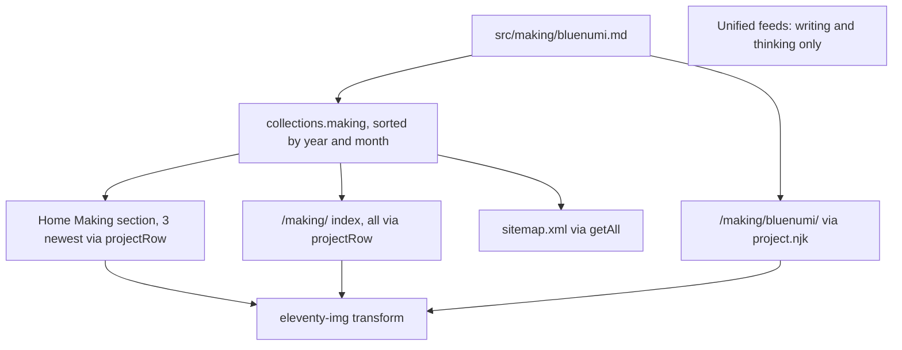

# Making Section - Plan

## Goal Capsule

- **Objective.** A visitor to seanvoisen.com can see the things Sean has made, such as hardware, installations and plotter art. They appear on the home page next to the writing and thinking, and each one has its own image-led page.
- **Means.** A Making section: a home page list taken from design H/1's thumbnails-in-gutter rows, a `/making/` index, and project pages built from the new `H · Project (Light)` board. Bluenumi is the first project.
- **Product authority.** Sean Voisen. The boards `H/1 — Thumbs in gutter (Mono, Light)`, `H/1 · Making (Phone, thumbs above)`, `H · Project (Light)` and `H · Project (Phone)` in `portfolio explorations.pen` (iCloud `Blog Designs`) set the visual intent. This document overrides them wherever structure or content disagree.
- **Execution profile.** Two to four commits on this branch. The repo has no test runner, so each unit is proven by a clean build and inspection of the generated HTML, plus a browser check at desktop width and 390px in both themes.
- **Stop conditions.** Stop and ask if a unit would change an existing URL, add projects to the feeds, or create topic pages from project labels.
- **Open blockers.** None for building. Going live waits on content, per R16.

---

## Product Contract

**Product Contract preservation:** changed: R10 (portrait captions sit below the image on phones) and added R19 (phone row layout). Both were confirmed with the user during planning after reviewing the phone boards. No other requirement changed.

### Summary

Add Making as a third kind of content, next to Writing and Thinking. The home page shows the three newest projects as thumbnail rows between Thinking and Reading. `/making/` lists every project, and each project gets a post-like page led by a cover image and large figures. Bluenumi, moved over from the old Jekyll site, is the first project.

### Problem Frame

The design H migration turned the site from a blog into a portfolio and blog, but it only made room for professional roles and writing. That plan deferred Projects explicitly because no content existed (`docs/plans/2026-08-21-1617-feat-portfolio-redesign-h-plan.md`, Scope Boundaries). The things Sean has built outside of work, like an open-hardware clock kit, a museum photo booth and plotter drawings, have nowhere to live. Their write-ups and photos are scattered across an old Jekyll archive and iCloud folders.

### Key Decisions

- **"Making" names the section everywhere, URLs included.** (session-settled: user-directed — chosen over a `/projects/` URL behind a "Making" label, with or without a nav entry: one name for one section.) Governs R6, R8, R13.
- **The year is required and the month is optional. The home page shows only the year.** (session-settled: user-directed — chosen over requiring both, or showing month and year on the home page: many old projects have no reliable month.) Governs R2, R3, R5.
- **Thumbnails are full colour with square corners.** (session-settled: user-directed — chosen over greyscale that turns to colour on hover, after seeing it built: reversed during implementation.) Governs R7.
- **Project pages have no link back to their index.** (session-settled: user-directed — chosen over a "← Making" breadcrumb: how every section's pages point back to their index is to be reviewed across the whole site, not decided for one section.) Governs R11.
- **Nothing goes live until two or three projects exist.** (session-settled: user-directed — chosen over launching with one row or hiding the section until three exist: a one-row section undersells the work.) Governs R16.
- **Projects stay out of the feeds.** (session-settled: user-approved — a dated 2011 project would sink deep into a date-sorted feed, and a feed entry for an old project reads as news.) Governs R14.
- **Each thumbnail is a crop of the project's cover image.** That leaves one image to supply per project, not two. Governs R7, R19.
- **On phones, thumbnails sit above the entry at full width.** (session-settled: user-directed — chosen over a thumbnail beside the entry and a small thumbnail above it: text beside a thumbnail never lines up with both of its edges.) Governs R19.

### Requirements

**Project content**

- R1. A project has a title, a one-line summary, a year, a cover image, and a body of prose and figures. It can also have a month, a few discipline labels (for example "Open hardware", "Electronics"), and one external link (for example, source code).
- R2. Projects run newest first, by year and then by month. In a given year, a project with no month comes after the projects that have one.
- R3. A project's date reads as "Mar 2011" when it has a month and "2011" when it doesn't.

**Home page**

- R4. A Making section sits between Thinking and Reading, so the order becomes Writing, Thinking, Making, Reading, Working.
- R5. Making lists up to three of the newest projects, per R2. Each row puts the thumbnail in the gutter and shows the year, the linked title and the summary beside it, following H/1.
- R6. The Making bar's right-hand link reads "All projects →" and goes to `/making/`.
- R7. Thumbnails show a crop of the cover in full colour, with square corners.

- R19. On phones, each Making row puts its thumbnail above the year, title and summary, running the full column width at a 2:1 crop.

**Making index**

- R8. `/making/` lists every project newest first in R5's row form and uses the section bar treatment the other index pages use.

**Project page**

- R9. Project pages live at `/making/<project>/` and follow the `H · Project (Light)` board. In order: title, summary as the standfirst, a meta row with R3's date and the discipline labels, then the external link at the right of the meta row when there is one.
- R10. A full-column cover image sits between the head and the prose. Landscape figures run the full column with a caption under them. Portrait figures run narrower, with the caption set beside them, and below them on phones.
- R11. A project page has no back link, tags, or "more" list. It ends where the prose ends, as posts do.
- R12. Project images display in full colour in both modes. Dark mode follows the same theme swap as posts, with no separate layout.

**Site continuity**

- R13. The Directory lists Making. The header nav doesn't change.
- R14. Project pages appear in the sitemap and not in the RSS or JSON feeds.
- R15. No existing URL changes.

**Launch**

- R16. The Making section isn't published until at least two projects have content. Bluenumi is one of them.

**First project: Bluenumi**

- R17. Bluenumi moves over from the old Markdown (`~/Desktop/bluenumi.md`) with the title "Bluenumi Clock", the year 2011, the summary "An open-hardware numitron clock kit", the features list, and a link to `https://github.com/svoisen/bluenumi`. The copy is lightly edited, with curly apostrophes.
- R18. Bluenumi's cover is the front three-quarter photo of the lit clock (`bluenumi_1`). The figures are the low side view (`bluenumi_3`, landscape) and the bare board on the bench (`bluenumi_2`, portrait), taken from the 1240px-wide originals in iCloud `Portfolio Assets/Bluenumi`.

### Acceptance Examples

- AE1. Ordering when a month is missing. Covers R2, R5.
  - **Given:** project A dated March 2016, project B dated 2016 with no month, and project C dated 2011.
  - **When:** the home page renders.
  - **Then:** Making lists A, B, C. All three rows show only the year.
- AE2. Fewer than three projects. Covers R5, R8.
  - **Given:** only two projects exist.
  - **When:** the site builds.
  - **Then:** Making and `/making/` each show two rows, with no placeholders or empty slots.
- AE4. Date on the project page. Covers R3, R9.
  - **Given:** a project with year 2011 and no month.
  - **When:** its page renders.
  - **Then:** the meta row starts with "2011", not with a month name or a placeholder.

### Scope Boundaries

- Writing the other projects (Self-Composed, Context, Madefire, plotter art). R16 depends on them, but they're content work outside this plan.
- How section pages link back to their index across the site, including whether project pages get a back link.
- A header nav entry for Making.
- Adding projects to the site's topics system. Discipline labels are plain text for now.
- A dark-mode project board in the Pen file.
- The 2012 date shown for Bluenumi on the H/1 board. The content says 2011.
- A per-project focal point for thumbnail crops. Considered and not built: every crop is centred, which suits Bluenumi. Add a focal point when a cover's subject sits off-centre.
- Per-project share images. Project pages use the site's default 1200×630 share image.

### Dependencies / Assumptions

- The Bluenumi photos are 1240px wide, a little under 2× the 720px column. They're assumed to look acceptable at full column width, since nothing sharper exists.
- The `H · Project (Light)` board's type, spacing and figure treatment come from `H · Essay (Light)` and the shipped post layout. Anything not drawn falls back to the post layout's existing styles.

### Sources / Research

- `docs/plans/2026-08-21-1617-feat-portfolio-redesign-h-plan.md`: the design H plan. It deferred Projects and set up the section bar, the gutter alignment line, and index page conventions (R13, R14, R23 there).
- `src/pages/home.njk`: current home section order and the gutter list macros it uses.
- `src/_includes/macros/gutter-list.njk`: the existing `entryRow` and `postRow` forms that the Making row sits beside.
- `src/_layouts/post.njk`: the reading view that the project page builds on, which already has no back link and nothing after the prose.
- `src/_config/collections.js`: how the writing and thinking collections and the unified feed are defined.
- `portfolio explorations.pen`, boards `H/1 — Thumbs in gutter (Mono, Light)` (Projects section and row metrics) and `H · Project (Light)`. The Bluenumi images the board references were copied to `Blog Designs/portfolio-assets/bluenumi/`.

---

## Planning Contract

### Key Technical Decisions

- KTD1. **Projects are a third Eleventy collection, `making`, globbed from `src/making/*.md`.** It mirrors `writing` and `thinking` in `src/_config/collections.js`. The feeds read only `unified`, which is built from writing and thinking, so they exclude projects without a change. The sitemap uses `collection.getAll()`, so it includes them without one. Governs R14, R15.
- KTD2. **The collection sorts itself oldest first by year, then month, with a missing month counting as 0. Templates reverse it.** That matches how `writing` and `thinking` are used (`| reverse`), and once reversed it puts a project with no month after the dated ones from the same year. Projects carry no `date`, so Eleventy's file date only feeds the sitemap's `lastmod`. Governs R2.
- KTD3. **The front matter fields are `title`, `description`, `year`, `month`, `disciplines`, `link` (`label` and `url`), `cover` and `coverAlt`.** `description` serves as both the summary and the standfirst, as it does on posts. The labels are deliberately not called `tags`, because `src/_config/collections/tags.js` collects `tags` from every item and would make topic pages from them. Governs R1, R9.
- KTD4. **A `projectDate` filter in `src/_config/filters/dates.js` formats the year and optional month.** Governs R3.
- KTD5. **The Making row is a new `projectRow` macro in `src/_includes/macros/gutter-list.njk`, with the thumbnail in the gutter cell.** Below 568px, the existing narrow-width rule in `global.css` already moves the gutter above the entry. The phone layout therefore only needs a full-width 2:1 thumbnail at that same breakpoint. On desktop the thumbnail is a 3:2 crop at the gutter width. Both crops come from the one cover image using centred `object-fit: cover`. The macro wraps the `` in its gutter ``, because the transform wraps every image in an unclassed `<picture>` that would otherwise fall into the entry column. Making rows align to `start` rather than the grid's `baseline`, so the year lines up with the top of the thumbnail. Governs R5, R7, R19.
- KTD6. **Thumbnails override the main column's rounded-image rule with a more specific selector.** The global rule rounds every image in an article by 8px. Governs R7.
- KTD7. **Project images live in `src/assets/images/making/<project>/` and go through the existing eleventy-img transform.** For a template-written `` with several widths, the transform needs an explicit `sizes`, otherwise it falls back to `sizes="auto"` on lazy images. So the cover and the thumbnail each set their own `sizes`.
- KTD8. **Portrait figures are written as raw `<figure class="figure--portrait">` HTML in the project Markdown.** The Markdown config has `html: true`, and the transform processes every `` in the built HTML. From 568px up, CSS sets the caption beside the image. Below that, the caption goes under it. Governs R10.
- KTD9. **Making styles live in a new `src/_includes/css/making.css`, loaded through `localCSS` on the home page, the Making index and the project layout.** The project layout reuses the post's header, standfirst, meta-row and content classes. Governs R9, R12.

### Assumptions

- The existing `.post-content figure` rules (full column width, centred caption, rounded corners) suit landscape project figures without changes.
- The transform doesn't upscale, so Bluenumi's 1240px originals are the largest width it generates.

### High-Level Technical Design

How one project file reaches each surface.

---

## Implementation Units

### U1. Making collection, project date filter, and directory data

**Goal:** Projects exist as a sorted collection with their own URLs and a formatted date.

**Requirements:** R1, R2, R3, R14, R15.

**Dependencies:** None.

**Files:**
- `src/_config/collections.js`
- `eleventy.config.js`
- `src/_config/filters/dates.js`
- `src/_config/filters.js`
- `src/making/making.json` (new)

**Approach:**
1. Add `making` per KTD1 and KTD2, and register it.
2. Add `projectDate` per KTD4, and register it.
3. The directory data sets `layout: project` and the permalink `/making/{{ page.fileSlug }}/index.html`.

**Patterns to follow:** `writing` and `thinking` in `src/_config/collections.js`, `monthYear` in `src/_config/filters/dates.js`, and `src/writing/writing.json`.

**Test scenarios:**
- Covers AE1. Given projects dated March 2016, 2016 with no month, and 2011, the reversed collection runs March 2016, then 2016, then 2011.
- `projectDate` gives "2011" for a year alone and "Mar 2011" for year 2011 with month 3.
- After a build, `dist/making/bluenumi/index.html` exists, and neither feed mentions `/making/`.
- `dist/sitemap.xml` lists `/making/bluenumi/`, and `/topics/` gains no topic.

**Verification:** A clean build produces the project page at its slug-only URL, and the feeds and topics are unchanged.

### U2. Project layout and page styles

**Goal:** A project page renders like the `H · Project` boards.

**Requirements:** R9, R10, R11, R12.

**Dependencies:** U1.

**Files:**
- `src/_layouts/project.njk` (new)
- `src/_includes/css/making.css` (new)
- `eleventy.config.js` (layout alias)

**Approach:**
1. The layout extends `base` and reuses the post classes per KTD9. The meta row carries the R3 date and the disciplines, with the external link on the right. Below 568px the link drops to its own line, as on the `H · Project (Phone)` board.
2. The cover image sits at full column width between the header and the content, with `sizes` set per KTD7.
3. Style `.figure--portrait` per KTD8.
4. Nothing follows the content, per R11.

**Patterns to follow:** `src/_layouts/post.njk` and the reading-view rules in `src/_includes/css/global.css`.

**Test scenarios:**
- Covers AE4. For a project with no month, the meta row starts with "2011".
- A project with no `link` shows no empty right-hand slot in the meta row.
- A project with no `disciplines` shows the date alone, with no dangling separator.
- At 390px the portrait caption sits under the image, and the external link sits on its own line under the date and labels. At desktop width the caption sits beside the image.
- Images stay in full colour in dark mode.

**Verification:** A clean build renders a project page with every field present. The visual comparison against the boards happens in U3, once Bluenumi exists.

### U3. Bluenumi content and images

**Goal:** Bluenumi is published as the first project.

**Requirements:** R17, R18.

**Dependencies:** U1, U2.

**Files:**
- `src/making/bluenumi.md` (new)
- `src/assets/images/making/bluenumi/` (new: three photos from iCloud `Portfolio Assets/Bluenumi`, renamed by subject)

**Approach:** Port the copy from the old Markdown, edited as on the `H · Project (Light)` board, with curly apostrophes. Write the landscape figure in Markdown image syntax and the portrait figure in KTD8's HTML.

**Test scenarios:**
- Test expectation: none -- content only. U2's checks run against this page.

**Verification:** `/making/bluenumi/` matches the desktop and phone project boards in both themes, apart from the deviations listed under Assumptions. Every image has alt text, and the GitHub link resolves.

### U4. Making row, home section, index and directory entry

**Goal:** Projects appear on the home page and at `/making/`.

**Requirements:** R4, R5, R6, R7, R8, R13, R19.

**Dependencies:** U1, U3.

**Files:**
- `src/_includes/macros/gutter-list.njk`
- `src/pages/home.njk`
- `src/pages/making.njk` (new)
- `src/_data/navigation.json`
- `src/_includes/css/making.css`

**Approach:**
1. Build `projectRow` per KTD5. The thumbnail has empty alt text because the title carries the name. The entry holds the year, the linked title and the summary.
2. On the home page, the Making section goes between Thinking and Reading and takes `collections.making | reverse | head(3)`. Its bar link reads "All projects" and points to `/making/`.
3. `/making/` is a `listPage`, like `thinking.njk`.
4. The `navigation.json` entry sets `inNavigation: false`.
5. Thumbnail styles per KTD5 and KTD6.

**Patterns to follow:** `entryRow` and `postRow`, `src/pages/thinking.njk`, and the narrow-width block in `global.css`.

**Test scenarios:**
- Covers AE2. With two projects (Bluenumi plus a temporary fixture), the home section and the index each show two rows and no empty slots.
- Thumbnails render in full colour with square corners in both themes.
- The home sections run Writing, Thinking, Making, Reading, Working.
- At 390px the thumbnail sits above the year at full column width and 2:1. At desktop width it sits in the gutter at 3:2, and the title lines up with the titles in the other sections.
- The Directory lists `/making`, and the header nav doesn't.

**Verification:** The home page and `/making/` match the H/1 desktop board and the `H/1 · Making (Phone, thumbs above)` board in both themes.

---

## Verification Contract

| Check | How | Units |
|---|---|---|
| Build | `npm run build` exits cleanly, with no eleventy-img `sizes` warnings | All |
| Generated HTML | Inspect `dist/` for each unit's URLs, ordering, feed exclusion and sitemap entry | U1, U4 |
| Visual | `npm start`, then compare against the Pen boards at desktop width and 390px, in light and dark | U2, U4 |
| Ordering and counts | Temporary fixture projects for AE1 and AE2, removed before committing | U1, U4 |

---

## Definition of Done

- Every unit's verification holds, and the build is clean.
- No existing URL changes, and the feeds and topic pages are unchanged.
- No temporary fixtures or abandoned experiments are left in the diff.
- The branch stays unmerged so the section stays unpublished until a second project exists (R16).
